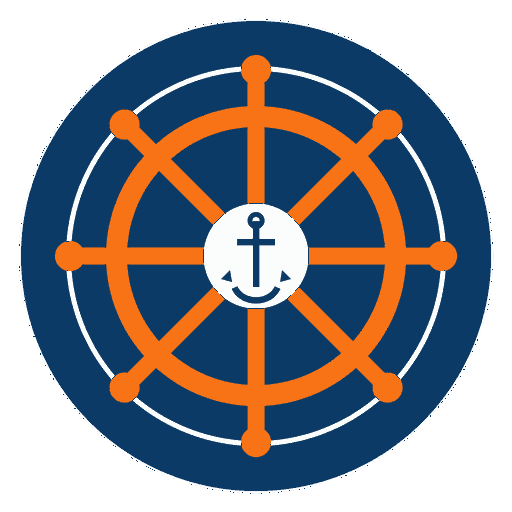
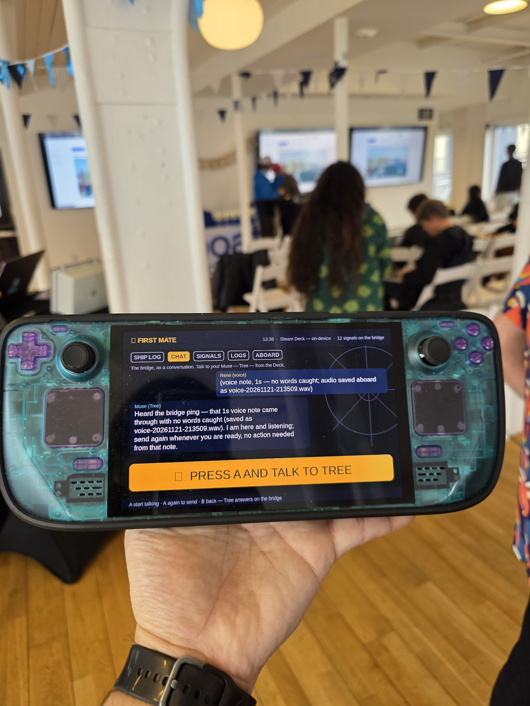

# First Mate



Disclosure: First Mate was built by AI agents directed by Rene Turcios for the Boat Hackathon.

We are building a helper that sits in a team chat.
It reads what the team shares and makes a simple list of what to do next, and it keeps it private.



*Demo Day, Nov 21, 2026, aboard the Historic Klamath at Pier 9: First Mate running as a native Steam Deck app, in Rene's hand, mid-demo. The screen is the bridge — the live conversation between Rene and his agent, Tree.*

## Demo Day update — Nov 21, 2026

First Mate grew from a web page into an agent that lives on one persistent machine. What shipped for Demo Day, all of it live and used at the table:

- **One persistent store.** Every Ship Log, check-off, voice note, and bridge signal is a file in one store on one machine (`data/ship-logs/`, `data/bridge.jsonl`). Nothing is copied between devices; every surface reads and writes the same store, and it survives restarts.
- **Native Steam Deck app** (`deck/native/first_mate_app.py`). A real pygame app launched from Steam — not a browser page. Five screens (Ship Log, Chat, Signals, Logs, Aboard) cycled with L1/R1, D-pad navigation, A to act: check off actions and watch the progress bar move. Controller input is verified from the app's own input log, from real presses.
- **Voice chat with the agent, transcribed on-device.** On the Chat screen, press A and talk; press A again to send. The Deck records, then transcribes locally with Vosk (small English model, fully offline — no audio leaves the machine). The transcript arrives as a bridge message and is also filed as a Ship Log automatically.
- **The bridge** (`POST`/`GET /api/bridge` in `deck/first_mate/deck_server.py`). An append-only signal channel between Rene and his agent, stored in the same persistent store. During Demo Day the agent answered Rene's voice notes on the bridge in about a minute, and filed the day's real fleet digest as a Ship Log.
- **Phone = capture.** A native Android app (and an installable PWA served by the Deck) for pasting or sharing a team chat straight into the store — no typing on the Deck, ever.
- **Watch = glance + act.** A native Wear OS app on a Galaxy Watch6 shows the latest Ship Log's next actions and checks them off against the same store.
- **Agent pack** (`deck/agent-pack/`). The charter, install guide, and fleet-report format that let an agent run First Mate as the keeper of a team's Ship Log: read `/llms.txt` first, work through the API, keep memory append-only, and never claim an integration that is not live.
- **Agent-readable by design.** `GET /llms.txt` and `GET /agent.json` publish the machine contract, so an agent can file a chat (`POST /api/ship-log`), read the result (`GET /api/latest`), check off work (`POST /api/actions/done`), and leave signals (`POST /api/bridge`) without scraping a screen.

The full Demo Day build record is in [`deck/BUILD-REPORT.md`](deck/BUILD-REPORT.md); the Deck build's own README is [`deck/README.md`](deck/README.md).

## What it does

Paste a team chat in, get a Ship Log out. The Ship Log lists:

- What to do next, as a checklist
- What the team decided
- The links the team shared, with a short note on each one and a label for how each link was read
- A short summary
- An All accesses section, listing every access the run made, and the ones it did not make, with the reason

Copy the Ship Log back into your team chat to share it. That is the whole product.

No sponsor credits, keys, or codes are needed for any of this. First Mate runs complete on free, no key modes. Keys, if you happen to have them, are optional upgrades only, and nothing in this project waits on them.

## Use cases

The full write up is in [USE-CASES.md](USE-CASES.md). The short version:

- **Hackathon and build weekend teams.** A dozen people drop links, decisions, and tasks into one chat for two days. First Mate turns that chat into one list of what to do next that the whole crew can check, instead of everyone scrolling.
- **Small startup teams with no project manager.** Standup notes, decisions, and owner names stop getting buried. Paste the chat, get the checklist and the decisions back as one message.
- **Event crews and volunteer teams.** The crew chat becomes the run sheet: who brings what, what was decided about rooms and timing, and what still needs checking before doors open.
- **Open source maintainers.** Release triage in chat becomes a Ship Log of what ships, what waits, and who checks what, ready to paste where the other maintainers will see it.
- **Class cohorts, clubs, and community groups.** Shared links and decisions from a busy group chat, collected into one post instead of lost in the scroll.
- **Privacy sensitive teams.** In the default Local only mode, the chat never leaves the machine, and the All accesses section proves it, run by run. Client work, internal planning, and unreleased product notes can be summarized without being sent to a random tool.

## Run it in production

You need Python 3.10 or newer. There are no packages to install, First Mate uses the standard library only.

### Check the configuration first

```bash
python3 -m first_mate config
```

This prints one JSON object: the hosting mode (local or Boat VM), the privacy mode, which link reading and inference routes will actually be used, and a warnings list. A partly configured optional route is never treated as live. The warning says what is missing and which free mode will be used instead, so there are no surprises in a run.

Health check, same idea:

```bash
python3 -m first_mate health
curl http://localhost:8000/health
```

The health output reports status ok, or degraded when the data folder is not writable, plus the same route summary.

### Local

```bash
python3 -m first_mate run sample/sample-chat.txt --out out
python3 -m first_mate serve
```

The web UI runs at http://localhost:8000 by default. Host and port are set with FIRST_MATE_HOST and FIRST_MATE_PORT.

### Docker

```bash
docker build -t first-mate .
docker run -p 8000:8000 -v first-mate-data:/app/data first-mate
```

The image has no dependencies to install and carries a Docker HEALTHCHECK against /health. The named volume keeps the Ship Log archive across restarts.

### Boat.dev VM

First Mate is built for Boat's persistent-VM thesis: an agent should live on a machine that never turns off, so its memory is still there tomorrow. It is packaged to move onto a Boat VM in one deploy — Dockerfile plus the step by step instructions in [deploy/boat.md](deploy/boat.md), plain Python and Docker options, with FIRST_MATE_ON_BOAT=1 set on the VM so every run record says plainly that the run was on a Boat VM.

**Honest status: First Mate has never run live on a Boat VM.** No Boat account or credits were available during the hackathon, so the deploy package is written and ready but unrun. The Demo Day demo ran on a Steam Deck standing in as the persistent machine — the same shape: one always-on machine, one store, every surface a window into it. It is one deploy away from a Boat VM, and that sentence is the whole claim.

### What every run writes

- `ship-log.md` and `ship-log.html` in the output folder
- `ship-log-meta.json` in the same folder: a structured record of the run, with the run id, timestamps, message, link, decision, and action counts, the privacy mode that was actually used, and the configured modes
- Archived copies of the log and its metadata in the data folder (FIRST_MATE_DATA_DIR, default `data/ship-logs`), named by run id so runs never overwrite each other

### Input limits and errors

One run accepts up to 1,000,000 characters and 10,000 messages. Bad input fails plainly, never with a traceback: the CLI exits with code 2 and a message that says what is wrong (no such file, not UTF-8 text, empty chat, chat too large), and the web UI answers 400 for a bad or empty chat and 413 for an oversized one. Malformed lines in a chat, lines with no speaker, stray separators, junk characters, are read as plain messages and never stop a run.

### Configuration

An `.env` file is optional. Copy `.env.example` to `.env` only if you already have a key and want an optional upgrade route used instead of the free mode. Every key is blank in `.env.example` on purpose. Bad values in numeric settings (FIRST_MATE_PORT, FIRST_MATE_FETCH_TIMEOUT) fall back to their defaults instead of crashing startup.

## How it uses the four hackathon tools

### 1. Teamily - the team chat

- Input: a Teamily group chat, exported or copied and pasted as plain text.
- Output: the Ship Log is a short markdown message, formatted to paste straight back into the Teamily group.
- Integration point: `first_mate/transcript.py` parses the pasted chat, and the web UI and CLI both end with the Ship Log in that paste-back format. There is no Teamily API key in this product, and none is claimed. The paste in, paste back loop is the integration, and it works with any Teamily export today.

### 2. Context.dev - reading links

- Adapter: `first_mate/context_dev.py`
- Default, free mode: with no key, it fetches each page directly and pulls out plain text with a simple HTML to text pass. This is a complete working mode, not a stub.
- Optional upgrade: when `CONTEXT_DEV_API_KEY` is set in `.env`, it calls the Context.dev web scrape API at `api.context.dev` (base URL configurable in `.env`) and asks for markdown for each shared link. If that call fails, it uses direct fetch instead.
- Honest labels: every link in the Ship Log says how it was read, `Context.dev`, `Direct fetch (fallback)`, or `Not fetched`. A failed fetch never stops the Ship Log, the link is kept for the team to open.

### 3. NY Token Exchange / TrustedRouter - private thinking

- Adapter: `first_mate/inference.py`
- Default, free mode: it uses a local extractive summarizer that runs in this process only. No network call is made, so no team content leaves the machine. This is the normal mode, and the demo runs complete in it.
- Optional upgrade: when a key (`NYTE_API_KEY` or `TRUSTEDROUTER_API_KEY`), a base URL, and a model are all set in `.env`, it sends the chat to that route in the common OpenAI compatible chat completions shape, for private inference. The base URL is configurable on purpose. This project does not guess an endpoint and present it as fact. A key on its own is not a live route, and `python3 -m first_mate config` warns about a partly configured route.
- Honest labels: every Ship Log says `Privacy mode: Private via NYTE` for that optional route, or `Privacy mode: Local only` for the default local mode.

### 4. Boat.dev - where it is built to live

- First Mate is built for Boat's persistent-VM thesis and packaged to deploy onto a Boat VM (Dockerfile + `deploy/boat.md`, FIRST_MATE_ON_BOAT=1). It has **not** run live on Boat yet — see the honest status under "Boat.dev VM" above. The All accesses panel says which hosting a given run actually used, and every verified run so far was local.
- Demo Day hosting: a Steam Deck as the persistent machine, running the Deck server (`deck/`) as an always-on service with the store on disk.
- Persistence: every Ship Log and its run metadata are archived to `data/ship-logs/` (configurable with `FIRST_MATE_DATA_DIR`); bridge signals are appended to `data/bridge.jsonl`.
- Health: `python3 -m first_mate health` on the command line, or `GET /health` on the web UI.

## All accesses: the website shows everything

Every run collects an access record as it goes, in `first_mate/accesses.py`. It is data collected during the run, not fixed text. The same record appears in three places: the All accesses panel on the web UI result page, the All accesses section in `ship-log.html`, and the Accesses section in `ship-log.md`.

It lists, with the time of the run:

- Teamily chat in: the source of the chat, and how many messages, links, decisions, and actions were read
- Each link access: the URL, the tool used (`Context.dev`, `Direct fetch (fallback)`, or `Not fetched`), and whether it worked or failed
- The AI access: `NY Token Exchange` private route if it was configured and used, otherwise `Local only`, with a clear line that no team data left the machine in local mode
- Boat.dev hosting status: running locally or on a Boat VM, and the health check result
- Ship Log out: where the files were saved, and that the log is formatted for Teamily

It also lists the accesses that were NOT made, and why. For example: `Context.dev: not used, no key, used direct fetch instead`, the NY Token Exchange route not used in local mode, the Teamily API not used (paste in, paste back), and a Boat VM not used when a run was local. A judge looking at the page can verify every sponsor tool was considered, and exactly how each one was used.

## 60 second live demo script

1. (0 to 10s) Say the two lines at the top of this README. Open the web UI. Say: no credits or keys are needed, this runs free.
2. (10 to 30s) Paste the sample chat from `sample/sample-chat.txt`. It has messy notes, three links, decisions, and tasks mixed together. Click "Make my Ship Log".
3. (30 to 45s) Show the Ship Log: a clean checklist of what to do next, the decisions, and the shared links. Point at the line `Privacy mode: Local only`. Say: nothing was sent to a random tool, and every link says how it was read.
4. (45 to 60s) Scroll to the All accesses panel. Show every access the run made, with times, and the accesses it did not make, with the reason for each one, like Context.dev not used because there is no key, with direct fetch used instead. Say: you do not have to trust the pitch, you can check the panel. Close with: copy this back into our Teamily group and the whole crew sees the same plan.

## Tests and verified runs

Tests, 32 tests, all passing, run 2026-11-20 and re-run 2026-11-21 against the Demo Day build:

```bash
python3 -m unittest discover -s tests -v
# Ran 32 tests, OK
python3 -m pytest tests/ -q
# 32 passed (2026-11-21)
```

The fleet testdelta gate was run against the pre-upgrade suite: NO-REGRESSION, 0 regressions, 18 tests added and passing, 14 unchanged, 0 removed.

The tests cover link extraction, decisions and action items, speaker parsing, the local summarizer, the rule that a key without a base URL is not treated as a configured private route, HTML to text cleanup, honest `Not fetched` labelling, building and saving a Ship Log, the All accesses record, and the v0.2.0 production behavior: empty, oversized, and malformed chat input, CLI error exits with no traceback, bad numeric environment values falling back to defaults, partly configured route warnings, the config check JSON, run metadata counts and its saved JSON files, and the web UI answering 400 and 413 on bad posts.

Verified runs, 2026-11-20, all in Local only mode, exit code 0:

```bash
python3 -m first_mate run sample/sample-chat.txt --out out
# 3 links, 4 actions, 4 decisions. Output saved as SAMPLE-OUTPUT.md.

python3 -m first_mate run sample/startup-product-team-chat.txt --out sample/outputs/startup-product-team
# 2 links, 6 actions, 4 decisions.

python3 -m first_mate run sample/event-crew-chat.txt --out sample/outputs/event-crew
# 1 link, 6 actions, 4 decisions.

python3 -m first_mate run sample/open-source-team-chat.txt --out sample/outputs/open-source-team
# 2 links, 5 actions, 4 decisions.
```

Each of these runs also wrote its `ship-log-meta.json` and archived copies named by run id. The three extra sample chats are different team types on purpose, a startup product team, an event crew, and an open source maintainer team, and their full outputs are saved under `sample/outputs/`.

Note on the demo runs in this sandbox: direct web fetch is not available here, so the sample links are honestly labelled `Not fetched` in the saved outputs, with the links kept in the log, and each link access is listed as Failed in the All accesses section. On a normal network, the same runs read them with direct fetch in the free mode, or with Context.dev if that optional key is set.

## Honest status

Version 0.2.0, the production hardening release, plus the Demo Day build of Nov 21, 2026 in `deck/`.

- Working now, no keys and no credits needed: chat parsing with input limits, decisions and action items, local summary, direct fetch link reading, Ship Log in markdown and HTML with the All accesses record, structured run metadata saved as JSON with every log, CLI with `run`, `health`, `config`, and `serve` commands, web UI with the All accesses panel, health and config checks, on-disk storage, 32 tests, Docker file, Boat VM deploy steps.
- Demo Day build, live at the table on Nov 21: the persistent store on a Steam Deck, the native Deck app with controller control, voice chat transcribed on-device (Vosk, offline), the bridge between Rene and his agent with answers in about a minute, the Android capture app and the Wear OS glance app, and the agent pack. The store aboard the Deck holds the day's real logs, including the fleet digest the agent filed during the demo.
- Error handling: bad input gets a plain message and a clean exit or HTTP status, never a traceback. Partly configured optional routes produce a named warning in the config check and are never claimed as used.
- Optional upgrades only, if keys happen to be available: Context.dev link reading instead of direct fetch, and NYTE / TrustedRouter private inference instead of the local summary. Neither is needed, neither is waited on, and neither is claimed as used unless a run actually used it. The All accesses panel shows which happened on each run.
- Teamily: paste in, paste back integration as described above. No API integration is claimed, and the All accesses record says so.
- Known limits, stated plainly: the web UI has no login or accounts, so run it where only your team can reach it, for example on a Boat VM or a private network, not exposed to the open internet as is. Link reading is one page at a time with a simple HTML to text pass, not a full browser. The summary in Local only mode is extractive, it picks the lines that carry decisions and next steps, it does not rewrite them.
- Boat VM status: **packaged, never run live on Boat.** The deploy steps in `deploy/boat.md` are written for this exact code, and the health command is the check to run on the VM — but no Boat account or credits were available during the hackathon, so no run has ever happened on a Boat VM. First Mate is built for Boat's persistent-VM thesis, demoed on a Steam Deck as the persistent machine, and is one deploy away from a Boat VM. Every verified run so far was a local run, and every record says so.
- Deck build limits, stated plainly: the native app and Deck server have no login or accounts — they run on the Deck and the local demo network only. Voice transcription uses the small Vosk model: the gist is right, individual words are sometimes wrong, and noisy rooms make it worse; the audio file is always kept aboard next to the transcript. The watch app reads the Deck at its local address, so it only works where the Deck is reachable on that network.

## Project layout

- `first_mate/transcript.py` - parses a pasted or exported team chat, with input limits and clear input errors
- `first_mate/context_dev.py` - Context.dev adapter with direct fetch as the free default
- `first_mate/inference.py` - NYTE / TrustedRouter adapter with local summary as the free default
- `first_mate/accesses.py` - the All accesses record, collected during each run
- `first_mate/ship_log.py` - builds, renders, and saves Ship Logs, run metadata, and the accesses section
- `first_mate/cli.py` - `run`, `health`, `config`, and `serve` commands
- `first_mate/server.py` - tiny web UI, standard library only
- `first_mate/config.py` - `.env` and environment config, mode summary and configuration warnings, no hardcoded keys
- `sample/sample-chat.txt` - the original sample messy team chat for the demo
- `sample/startup-product-team-chat.txt`, `sample/event-crew-chat.txt`, `sample/open-source-team-chat.txt` - sample chats from three other team types
- `sample/outputs/` - the saved Ship Logs and run metadata from the verified sample runs
- `tests/test_first_mate.py` - tests
- `deploy/boat.md` - how to run it on a Boat.dev VM
- `SAMPLE-OUTPUT.md` - actual output of the verified demo run
- `USE-CASES.md` - the full use cases write up
- `deck/` - the Demo Day build (Nov 21, 2026), mirroring the folder that runs on the Steam Deck
- `deck/deck.py`, `deck/launch.sh`, `deck/steam-launch.sh` - Deck server entry points
- `deck/first_mate/deck_server.py` - the Deck server: Ship Log API, bridge (`/api/bridge`), phone and watch surfaces, `/llms.txt` and `/agent.json`, inbox auto-import
- `deck/first_mate/qrmini.py` - vendored single-file QR library (qrcodegen, MIT) for the phone pairing code
- `deck/native/first_mate_app.py` - the native Steam Deck app (pygame): five screens, controller input, voice recording with on-device Vosk transcription
- `deck/agent-pack/` - AGENT.md charter, INSTALL.md, FLEET-REPORT-FORMAT.md: how an agent runs First Mate
- `deck/BUILD-REPORT.md` - the full build record, including Demo Day
- `deck/README.md` - the Deck build's own README, as written during the hackathon
- `docs/demo-day-deck.jpg` - First Mate in Rene's hand at Demo Day, Nov 21, 2026
